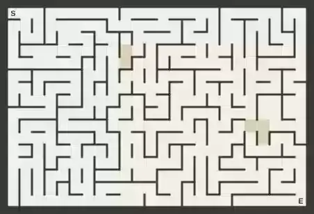

# svgrace

**An SVG that solves its own maze.** There is no script in the file. Every number it computes is a
time, and the computer is the browser's animation scheduler, doing its ordinary job of deciding when
each animation starts.

**[Watch it run](https://fmindstormer.github.io/svgrace/)**: the clocked build, a maze with loops and
terrain, on a page with no script. Reload to run it again.

[](https://github.com/fMindstormer/svgrace/actions/workflows/checks.yml)



*`examples/maze.svg` running in Chromium, recorded from the real file. The orange front is the set of cells
the scheduler is settling; the gold route is the cheapest way from S to E (darker cells cost more).*

The maze below is the file itself, not a recording. GitHub shows it through a plain ``, where no
script can run, and the browser computes its route as the page loads (checked in Chromium, Firefox and
WebKit; reload the page to run it again):



The SVG animations (SMIL) that make icons spin can start when another animation starts or ends, plus a
delay. That one feature is a model of computation with a name: **race logic**, computing with the
arrival times of signals. "Start at the earliest of these" is a minimum, a delay is an addition, and
together they are one step of Dijkstra's shortest-path algorithm. svgrace compiles a maze into such an
SVG. The wave you watch spreading through it is the browser settling cells in order of distance; when
it reaches the exit, a trace runs back and lights every cell on a cheapest route. The same compiler finds
the [edit distance](#a-second-program-edit-distance) between two strings.

## The machine

Each cell has an animation `R` that starts when the cell is reached. Its `begin` lists every neighbour:

```xml
<animate id="R57" begin="R56.begin+0.2s; R33.begin+0.2s; R81.begin+0.2s" restart="never" …/>
```

A begin list takes its earliest instance, so `R57` starts at min over neighbours of (their start + the
cost of entering cell 57). That is the relaxation step of Dijkstra's algorithm, and the scheduler applies
it to every cell. Cells cost 1, 2 or 3 to enter (the darker terrain), so the cheapest route is not the
one with the fewest steps.

| Race logic | SMIL timing |
|---|---|
| a signal arriving at time t | an animation beginning at t |
| delay by d | `begin="X.begin+ds"` |
| min (first arrival) | a begin list: `begin="X.begin; Y.begin"` |
| a gate: pass B only if A came first | an element begun by A and ended by B: its end fires at B only if A was earlier |
| a write-once bit | `restart="never"`: once an element has begun it can never begin again |

The last two rows find the route. For each passage j → i, a *winner* element begins when j's claim on i
arrives and is ended just after i is reached. An element only ends at a time after its begin, so the end
fires only if j's claim was not later than i's reach, which means j is a cheapest way into i. A *relay*,
armed by that end, passes the trace from i back to j. The trace starts at the exit and follows winning
passages only, so it lights exactly the cells on cheapest routes, and all of them when there are ties.

## Two ways to say "after", and what each costs

SMIL has two ways to make one animation follow another, and Chromium treats them very differently.

**Syncbase timing** (`R56.begin+0.2s`) is exact: the times are pure arithmetic. But Chromium resolves
them ahead of the clock, as soon as the document loads, by propagating every improvement through the
dependency graph at once, depth first. That is the textbook worst case of label-correcting shortest-path
algorithms, and the cost grows exponentially with the number of alternative routes. Firefox and WebKit
load the same files at once ([`tools/cliff.py`](tools/cliff.py), on one Apple-silicon Mac):

| File | Timing | Chromium 156 | Firefox 157 | WebKit 27.2 |
|---|---|---|---|---|
| perfect maze 24×16 (384 cells, one route) | syncbase | 0.04 s | 0.09 s | 0.05 s |
| perfect maze 32×20 (640 cells) | syncbase | 0.05 s | 0.11 s | 0.06 s |
| braid maze 12×9 (108 cells, 15% of walls removed) | syncbase | 0.06 s | 0.11 s | 0.02 s |
| braid maze 14×10 (140 cells) | syncbase | 2.49 s | 0.11 s | 0.02 s |
| braid maze 16×11 (176 cells) | syncbase | 50.19 s | 0.12 s | 0.02 s |
| the same maze | event-based | 0.03 s | 0.12 s | 0.03 s |
| braid maze 40×30 (1,200 cells) | event-based | 0.10 s | 0.23 s | 0.12 s |
| grid 5×5 (25 animations) | syncbase | 0.08 s | 0.10 s | 0.01 s |
| grid 6×6 (36 animations) | syncbase | 15.09 s | 0.10 s | 0.02 s |
| grid 7×7 (49 animations) | syncbase | over 100 s | 0.10 s | 0.01 s |

The grids are the smallest form of it: k × k `<animate>`s, each beginning 0.1 s after the earliest of its
neighbours, and nothing else. Repeated runs vary (12 to 15 s for the 6×6 grid, 50 to 80 s for the 176-cell
maze). The cliff was first measured on Chromium 141 in a 2-core Linux container, where a 216-cell braid maze
took over 5 minutes.

**Event-based timing** (`R56.beginEvent+0.2s`) cannot be predicted: a time exists only once its event
has fired, so the engine settles cells in clock order, the way Dijkstra's priority queue would, and the
cost is linear. But Chromium stamps an event with the time of the frame that delivered it, so every hop
adds up to a frame of error: in a test chain, a cell due at 1.30 s arrived at 1.40 s.

**The clock.** The original race-logic hardware used clocked delays, and so does svgrace. A clock
animation ticks every 0.1 s. A cell's delay runs a little short of its cost, then a *snap* element waits
for the next tick, so frame jitter is absorbed at every hop instead of accumulating. Cells are reached on
whole ticks, exactly. Each cell takes the minimum over its neighbours first and snaps once, because a
passage's cost is the cost of the cell it enters; that keeps the clock's listeners to one per cell.

The price is real time: a snap fails if the engine falls more than about three quarters of a tick
behind, so the clock rate is limited by how fast the engine runs frames.

## Findings in Chromium

- **Syncbase resolution is exponential** in the number of alternative routes (table above). Thirty-six
  animations in a 6×6 grid take 12 to 15 s to load, and shown through a plain `` they hold up the
  load of the page around them about as long. Seeking afterwards is instant: the cost is all in resolving
  the dependency graph at load. A report is drafted in [`upstream/chromium/`](upstream/chromium/).
- **A zero-length interval never ends.** An interval whose begin and end are the same time does not exist
  in Chromium, so nothing waiting for its end begins. SMIL 3.0 says such an element still ends and
  "propagate[s] to time dependents", and Firefox and WebKit agree. svgrace's gates never meet an exact
  tie: they end a quarter tick after the cell is reached.
- **Event times are frame times.** An event-based time is the time of the frame that delivered the
  event, not the time the event belonged to, so unclocked event chains drift. Firefox and WebKit drift
  less, but none of the three is exact (below).
- **No events inside ``.** Chromium does not run event-based timing in an SVG shown as an image:
  only the start cell animates. Syncbase timing does run there. Firefox and WebKit run both.
- **The clock's speed limit.** On a 2-core container (headless Chromium, software rendering), with
  24×16 braid mazes (384 cells, about 3,650 timed elements), a tick of 0.1 s was exact in 20 of 20 runs
  and 0.08 s in 8 of 8; 0.06 s failed occasionally. At 40×30 (1,200 cells, about 11,470 elements)
  frames ran 50 to 67 ms late: 0.15 s failed in 2 of 3 runs, and 0.3 s was exact in 3 of 3. The
  engine's work per frame grows with the number of elements, so a bigger maze needs a slower clock.

So there are two builds. `--timing syncbase` on perfect mazes runs anywhere an SVG animates, including a
GitHub README. `--timing clocked` handles mazes with competing routes, in a page that embeds the SVG with
`<object>` or inline, or opened directly.

## Three engines

The same checks in Playwright's builds of Chromium, Firefox and WebKit, on one Apple-silicon Mac:

| Check | Chromium 156 | Firefox 157 | WebKit 27.2 |
|---|---|---|---|
| syncbase, 24×16 perfect mazes, times read at load | 30 of 30 | 30 of 30 | 30 of 30 |
| syncbase, 12×9 braid mazes, times read at load | 30 of 30 | 30 of 30 | **3 of 30** |
| clocked, 24×16 braid mazes, real time, 0.1 s tick | 10 of 10 | 10 of 10 | 10 of 10 |
| syncbase inside ``, the README case | 3 of 3 | 3 of 3 | 3 of 3 |
| clocked inside `<object>`, the live page | 3 of 3 | 3 of 3 | 3 of 3 |

The README maze and the live page compute the right answer in all three. WebKit's braid-maze failures are
all in the trace, which lights cells off the cheapest routes. A winner gate whose end is corrected to
before its begin keeps the interval it had, so its relay fires: in two failing 12×9 mazes, over a hundred
gates that SMIL closes kept an interval in WebKit, and none did in Chromium. Chromium has the same flaw in
another document order (probes below), one that svgrace's mazes do not produce.

[`tools/engines.py`](tools/engines.py) probes the timing features svgrace uses one at a time, each against
what SMIL 3.0 requires. Every probe element has `restart="never"`, as svgrace's do:

| Probe | SMIL 3.0 | Chromium 156 | Firefox 157 | WebKit 27.2 |
|---|---|---|---|---|
| begin list takes the earliest | `begin="0.3s; 0.1s"` begins at 0.1 s | 0.1 | 0.1 | 0.1 |
| open cycle | A `0s; B.begin+1s`, B `A.begin+1s`: A at 0, B at 1 | 0, 1 | 0, 1 | 0, 1 |
| closed cycle | A `B.begin+1s`, B `A.begin+1s`: both unresolved | none, none | none, none | none, none |
| gate, end after begin | W is 1 s to 1.5 s, X begins at 1.5 | 1.5 | 1.5 | 1.5 |
| gate, end equals begin | a 0-length interval still ends and "propagate[s] to time dependents": X at 1 | **none** | 1 | 1 |
| the same, clock running | X at 1 | **none** | 1 | 1 |
| gate, end before begin | no interval, so X never begins | none | none | none |
| gate, end corrected to before begin | "the interval must be pruned and all dependent instance times must be removed": X never begins | **0.5, 3** | 0.5, none | **0.5, 3** |
| the same, elements in another order | X never begins | 0.5, none | 0.5, none | 0.5, none |
| `restart="never"` while active | `begin="0s; 0.5s"`, 2 s long: at 1 s still the interval from 0 | 0 | 0 | 0 |
| `restart="never"` after the end | `begin="0s; 3s"`, 1 s long: inactive at 3.5 s, width stays 10 | 10 | 10 | 10 |
| the same two, after `setCurrentTime()` | a forward seek "should" leave the state playing would: 0, and 10 | 0, 10 | 0, 10 | **0.5, 15** |
| `restart="always"` while active (control) | the first probe with restart="always": restarted at 0.5 | 0.5 | 0.5 | 0.5 |
| event-based chain | `prev.beginEvent+0.1s`, 20 hops: an event's time is "the earliest time that the event could be raised" (largest error) | **67 to 100 ms** | **3 to 48 ms** | **28 to 35 ms** |
| `getStartTime()` after the interval ends | 0.5 s long, read at 1 s: unspecified (SVG 1.1 throws without a "current interval") | 0 | none | 0 |
| syncbase timing inside `` | SVG Integration: "declarative animation: yes" in an image; the chain turns it red | red | red | red |
| event-based timing inside `` | the same chain with `beginEvent` | **teal** | red | red |

Bold: differs from SMIL 3.0. The event-based chain is given over four runs.

- **Event times.** SMIL defines an event's time as "the earliest time that the event could be raised",
  which would make unclocked event chains exact. None of the three engines does that, so the clock is what
  makes the clocked build exact in all three.
- **Seeking.** WebKit's `setCurrentTime()` restarts `restart="never"` elements that playing to the same
  time does not.
- **Reading the answer.** Once an interval has ended, Firefox's `getStartTime()` throws where Chromium and
  WebKit still answer, and the specification does not say which is right, so the checker reads the times
  while the race runs. Reading too often has its own cost: every half second, reading a 24×16 maze held up
  Firefox's main thread enough that clocked snaps missed their tick; every 2 s it does not.

The two clearest disagreements are drafted as [web-platform-tests](upstream/wpt/) for `svg/animations`: a
zero-length interval must end and propagate (Chromium fails), and a pruned interval must take back the
times it gave its dependents (Chromium and WebKit fail, in one document order). Firefox passes both.

## A second program: edit distance

Race logic was first used to align DNA (Madhavan, Sherwood and Strukov, below). svgrace compiles that
problem too:

```sh
python -m svgrace align KITTEN SITTING --out align.svg
```



Cell (i, j) stands for the first i letters of KITTEN aligned with the first j of SITTING. A step down
deletes a letter, a step right inserts one, and a diagonal step keeps one: free where the two letters
match (the strokes) and costing 1 where they differ. The edit distance is the cost of the cheapest walk
from the top left corner to the bottom right. The wave is the scheduler settling cells in order of cost,
the gold cells are every cell on a cheapest alignment, and the number in the corner is a counter that the
corner's arrival stops, so it shows the distance the race found. Like the maze above, this file runs
inside a plain `` (checked in Chromium and WebKit).

The compiler now takes any directed graph whose edges cost whole numbers of ticks; the maze and the
alignment are two front ends that build one, and the maze files come out byte for byte as before. Four
things are new:

- **A price per step.** A maze's passage costs the cell it enters, so a cell takes the earliest of its
  neighbours first and pays once. An alignment's diagonal costs 0 or 1 where the straight steps cost 1,
  so where the letters differ, each step runs its own delay before the minimum, and its winner gate
  compares the end of that delay with the first of them. Delays that end on the same tick can come from
  cells reached on different frames, so the gate allows half a tick either way, where the maze's allows a
  quarter. Where the letters match, all three steps cost the same and the cell keeps the maze's form.
- **No free steps on the clock.** A clocked delay runs its cost less three quarters of a tick, then waits
  for the tick, so every step must cost a tick or more. The clocked build charges one more per letter a
  step consumes: delete 2, insert 2, match 2, substitute 3. Every walk to cell (i, j) consumes i + j
  letters, so all of them gain the same i + j ticks: the cheapest walks stay the cheapest, and the
  distance is the corner's arrival minus n + m ticks. The syncbase build keeps the plain costs, `+0s`
  included.
- **A readout.** The corner holds a column of numbers behind a window, moved up one per tick from n + m
  ticks after the start (0 in the syncbase build) and frozen by the corner's arrival.
- **The timing on one element.** In the maze, each cell's reach and trace animations sit on the cell. In
  the alignment they sit with the rest of the timing on one invisible element, and each cell shows a copy
  that begins with them. That changed nothing in Chromium, but it made WebKit's syncbase build exact (the
  last three rows below are `compile_align(..., hoist=False)`). The maze keeps its published form, so
  its braid-maze failures in WebKit stand.

**Document order and the cliff.** An alignment grid is all alternative routes, the shape that makes
syncbase timing exponential in Chromium. But every step goes down or right, so writing the cells row by
row puts each element after every element its begin depends on. In that order Chromium loads syncbase
alignments of up to 4,290 cells in under a second; the same files with their elements reversed fall off
the cliff at 49 cells ([`tools/order.py`](tools/order.py), random strings over ACGT, then two pairs with
many cheapest alignments):

| Strings (Chromium 156.0.8078.4) | Cells | Syncbase, row by row | Syncbase, reversed | Clocked |
|---|---|---|---|---|
| random, 4 and 4 | 25 | 0.05 s | 0.04 s | 0.03 s |
| random, 6 and 6 | 49 | 0.03 s | 15.19 s | 0.03 s |
| random, 8 and 8 | 81 | 0.03 s | **over 60 s** | 0.04 s |
| random, 10 and 10 | 121 | 0.04 s | not run | 0.04 s |
| random, 12 and 12 | 169 | 0.04 s | not run | 0.04 s |
| random, 16 and 16 | 289 | 0.05 s | not run | 0.06 s |
| random, 24 and 24 | 625 | 0.08 s | not run | 0.10 s |
| random, 32 and 32 | 1,089 | 0.12 s | not run | 0.18 s |
| random, 48 and 48 | 2,401 | 0.26 s | not run | 0.37 s |
| random, 64 and 64 | 4,225 | 0.61 s | not run | 0.83 s |
| AB×32 and BA×32 | 4,225 | 0.55 s | not run | 0.77 s |
| A×64 and A×65 | 4,290 | 0.49 s | not run | 0.68 s |

WebKit loads every one of them in under a second row by row, and in under 3 s reversed. This fits
Chromium pushing each new time at once into the elements it has already resolved, while the ones still to
come just collect it; I have not read the source. A maze has no such order, since its passages go both
ways.

**Two engines.** The checks, in Playwright's builds on one Apple-silicon Mac:

| Check | Chromium 156 | WebKit 27.2 |
|---|---|---|
| syncbase, 12 and 12 random letters of ACGT, times read at load | 30 of 30 | 30 of 30 |
| syncbase, 12 and 12 random letters of AB (more ties), times read at load | 30 of 30 | 30 of 30 |
| clocked, 16 and 16 random letters of ACGT, real time, 0.1 s tick | 10 of 10 | 10 of 10 |
| syncbase, 8 and 8 random letters of ACGT, real time, the readout too | 3 of 3 | 3 of 3 |
| syncbase inside ``, the README case | 3 of 3 | 3 of 3 |
| clocked inside `<object>` | 3 of 3 | 3 of 3 |
| syncbase, ACGT, with the timing on the cells (three runs) | 30 of 30 each | **1 to 6 of 30** |
| syncbase, AB, with the timing on the cells (two runs) | 30 of 30 each | **1 or 2 of 30** |
| syncbase inside ``, with the timing on the cells | 3 of 3 | **0 of 3** |

With the timing on the cells, WebKit got every time right and every failure was in the trace, which lit
cells off the cheapest alignments; how many failed changed from run to run. Both builds are now exact in
both engines, so `align` keeps the clocked default that `build` has, and `--timing syncbase` writes the
build that runs inside ``, the one above. Firefox was not run for this section: Playwright's Firefox
did not start in the sandbox these runs used. The logs are in [`results/align.txt`](results/align.txt).

## How it is checked

The checker never trusts the picture: it computes the answer separately (Dijkstra, or the edit-distance
table) and compares.

| Claim | Evidence |
|---|---|
| Every cell is reached at its cheapest cost | each `R`'s start time, read back with `getStartTime()`, rounded to whole ticks after the start cell's, equals Dijkstra's distance |
| The trace lights exactly the cheapest routes | the set of cells whose `T` began equals the set of cells on some cheapest route (from forward and backward Dijkstra) |
| It works where it will be shown | pixels after the race: gold cells must equal the route cells |
| The corner gives the edit distance | the corner's reach time in ticks, less n + m in the clocked build, equals a plain Python edit distance; every other cell's equals the distance between the two prefixes; the readout shows the same number |
| The trace lights exactly the cheapest alignments | the lit cells are the cells where the forward and backward distance tables add up to the distance; on short strings, both agree with every walk enumerated |

The results in each engine are in [Three engines](#three-engines). Before that, on Chromium 141 in a
2-core Linux container: clocked 24×16 with loops, 20 of 20 mazes; syncbase 24×16 perfect mazes, 30 of 30;
syncbase 12×9 with loops, 30 of 30; syncbase inside ``, 4 of 4; clocked inside `<object>`, 3 of 3.

```sh
pip install -r requirements.txt && python -m playwright install chromium firefox webkit
python -m svgrace check 24 16 --seeds 20                    # clocked, real time
python -m svgrace check 24 16 --seeds 30 --loops 0 --timing syncbase --mode paused --engine firefox
python tests/img_check.py --timing syncbase --tag img       # the README case
python tools/engines.py                                     # the probes, in all three engines
python tools/cliff.py                                       # the load times
python tools/wpt.py                                         # the web-platform-tests drafts
python -m svgrace build 24 16 --seed 3 --out maze.svg       # make one
python -m svgrace check 16 16 --align --seeds 10            # alignments of random strings, clocked
python tests/img_check.py --align --size 12x12              # syncbase alignments inside 
python tools/order.py                                       # syncbase alignments, row by row and reversed
python -m svgrace align KITTEN SITTING --out align.svg      # make one
```

## Limits and next steps

- **Three builds on one machine.** The engines are Playwright's builds on an Apple-silicon Mac. Safari,
  and Chrome and Firefox elsewhere, are not tested; Safari in particular may differ from Playwright's
  WebKit.
- **Two programs.** Mazes and edit distance. The compiler takes any directed graph with whole-number
  costs, so other dynamic programmes on a grid (longest common subsequence, alignment with integer
  substitution scores) need only a new front end. Sorting, which the same primitives also compute, is not
  built.
- **Universality.** With cycles and restarts, the same elements make temporal state machines: a counter
  can be held as the offset between two looping pulses, incremented or decremented by delaying one of
  them, and tested for zero by which arrives first. That should make SMIL timing Turing complete up to
  the engine's time precision; the construction is not built yet.
- **Upstream.** The Chromium report and the web-platform-tests are drafted in [`upstream/`](upstream/)
  and not yet submitted.

## Prior art

Race logic: A. Madhavan, T. Sherwood and D. Strukov, "Race Logic: A Hardware Acceleration for Dynamic
Programming Algorithms", ISCA 2014. Space-time algebra: J. E. Smith, ISCA 2018. Temporal state machines:
[arXiv:2009.14243](https://arxiv.org/abs/2009.14243). The SMIL timing model: [SMIL 3.0](https://www.w3.org/TR/SMIL3/smil-timing.html),
and its use in [SVG](https://www.w3.org/TR/SVG11/animate.html). I found no earlier use of SMIL timing to compute, in a
search in October 2026; that is not proof that none exists.

## License

MIT, Fedir Yudin. See [LICENSE](LICENSE).
